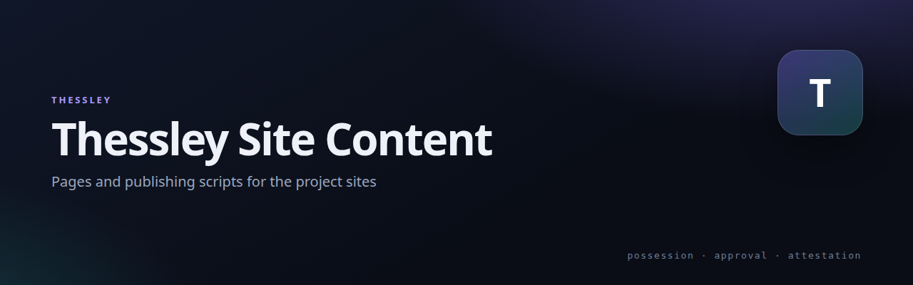

# Thessley Site Content

HTML and publishing scripts for the project pages served from the OPI5.

## Pages

| Page | Source | Publisher |
|---|---|---|
| Windows Pro install | `windows-pro-install.html` | `publish-windows-pro-install.php` |
| AD service install | `ad-service-install.html` | `publish-ad-service-install.php` |
| Downloads | `downloads.html` | `publish-downloads.php` |
| Passkey protocol | `passkey-protocol.html` | `publish-passkey-protocol.php` |

The `publish-*.php` files are `wp eval-file` scripts: they create or update the matching WordPress page, so content lives here in git and is pushed to the site as a deliberate step.

## Related

- [Thessley](https://github.com/netmate1234/Thessley) — overview and the other projects
- [Releases](https://github.com/netmate1234/Thessley/releases) — the zips these pages link to

## License

GPL-2.0-or-later.
